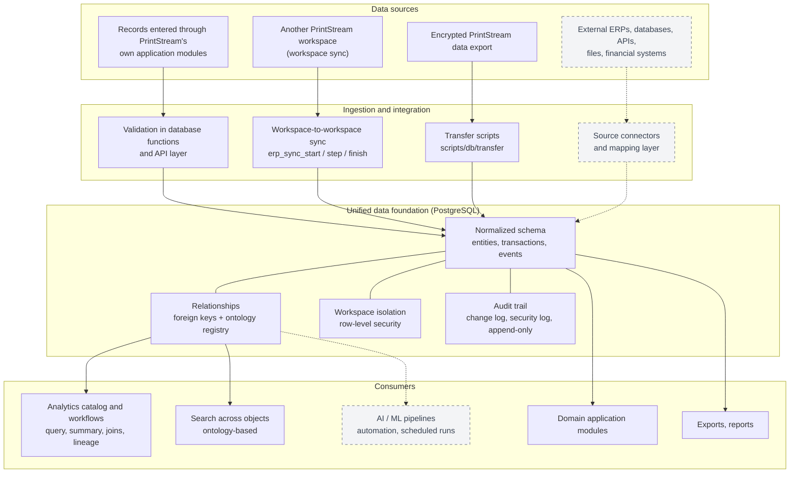

# PrintStream

**by ETNA — Enterprise Transformation & Intelligence Architecture**

PrintStream is a proprietary data integration and intelligence platform for connecting, structuring, analyzing, and operationalizing enterprise data.

---

## Overview

Organizations keep their data in many places: ERP systems, databases, financial and operational systems, APIs, spreadsheets and files, external sources, and internal applications. Each system has its own structure, identifiers, and rules, so a question that spans several of them has no single place to be answered.

PrintStream is an architecture for bringing such data into one controlled environment: a unified data model in which entities, transactions, and events are structured, related to each other, access-controlled, and traceable, and from which analytics, automation, and applications can work.

The central flow is:

```
DATA SOURCES → INGESTION → INTEGRATION → NORMALIZATION → UNIFIED DATA MODEL
→ ENTITIES / RELATIONSHIPS / EVENTS / TRANSACTIONS
→ ANALYTICS / AUTOMATION / APPLICATIONS / DECISION INTELLIGENCE
```

Not every stage is built yet. See [Project status](#project-status) for what exists today.

## What PrintStream Is

- Data integration infrastructure.
- Data intelligence infrastructure.
- A unified enterprise data layer: one schema, one access model, one audit trail.
- An integration and orchestration layer between data and the applications that use it.
- A foundation for analytics and decision systems.

## What PrintStream Is Not

PrintStream is not an ERP.

PrintStream does not attempt to replace specialized enterprise applications. It can integrate data from ERP systems and other enterprise systems and make that data usable for analytics, intelligence, automation, and downstream applications.

PrintStream does not try to be every business application. It provides the data integration and intelligence foundation that allows those applications and analytical systems to work from a unified data environment.

> **Naming note.** The repository currently contains domain application modules (sales, purchasing, stock, ledger, payroll, and others) that serve as the first data domain and reference application on the platform. Their code lives under `src/app/erp` for historical reasons. They are a layer on top of the data foundation, not its identity. See [Project status](#project-status).

## Architecture

The diagram separates what exists in this repository from what is a design direction. Dashed boxes are **not implemented**.



How the request path works today:

1. The browser never talks to PostgreSQL. Every request goes to the Next.js server.
2. The server resolves the session, validates the request, and opens a database transaction as the signed-in user.
3. The database applies row-level security, workspace rules, and integrity triggers, and records the change in the audit log.

## Core Capabilities

Each item below exists in the repository.

**Unified data model**
- A normalized relational schema in PostgreSQL, built from 60+ migrations with rollbacks (`db/migrations`, `db/rollback`).
- Master data (customers, suppliers, products), documents (orders, invoices, payments), stock movements, and a double-entry ledger share one schema and reference each other through foreign keys.
- Gap-free document numbering and a balanced-journal constraint enforced in the database.
- Multi-currency support with exchange rates and a base currency (`docs/CURRENCY.md`).

**Data integration**
- Workspace-to-workspace sync between PrintStream workspaces: customers, suppliers, products, stock, orders, invoices, and payments (`erp_sync_*`, `tests/db/erpSync.test.mjs`).
- Encrypted export and import of whole data sets between PrintStream databases (`scripts/db/transfer.mjs`).
- Document storage with integrity checking (SHA-256 verified on read).

**Entities and relationships**
- An ontology registry that describes business objects, their properties, and their relationships as a map over existing tables, with a cross-object search page (`src/lib/ontology`, `docs/ONTOLOGY.md`).

**Analytics and transformation**
- An analytics catalog of 14 entity types with typed fields and relations (`src/lib/analytics/catalog.ts`).
- Visual, read-only workflows: sources, filters, joins, calculated fields (arithmetic only), aggregation, data-quality validation, branching, statistics, and table, chart, KPI, and CSV outputs (`docs/WORKFLOWS.md`).
- Database-computed summaries with drill-down to the underlying records.
- Column lineage tracked through workflow steps, and refusal of operations that would produce misleading totals (repeated parent values, mixed currencies).
- Versioned workflows and run history.

**Auditability and traceability**
- A change log written by database triggers on business tables.
- An append-only security log in a separate schema; updates, deletes, and truncation are rejected.
- Reversal entries instead of edits for financial records.

**Access control**
- Row-level security on all application tables, per-workspace roles, and read areas (`docs/ROLES.md`).
- An internal admin panel with platform roles and re-authentication for changes (`docs/ADMIN.md`).

**Application and backend services**
- Server-side API in Next.js route handlers; own authentication with TOTP two-factor.
- Domain application modules for sales, purchasing, stock, accounting, HR and payroll, and industry modules (weighbridge, production, equipment) (`docs/INDUSTRY-MODULES.md`).
- E-mail sending through a built-in SMTP client; backups and a health endpoint.

## Use Cases

These describe what the architecture is for. The notes say what the repository supports now.

**ERP data integration.** Ingest and unify data from existing ERP systems rather than replacing them. *Today:* the schema and sync mechanisms exist for PrintStream's own data; connectors for third-party ERPs are not implemented.

**Financial analytics.** Analyze integrated financial and transactional data. *Today:* invoices, payments, cash transactions, and ledger data in PrintStream can be analyzed through the analytics catalog and workflows.

**Business intelligence.** Provide structured enterprise data to analytical applications. *Today:* the analytics catalog, summaries, and exports serve this inside PrintStream.

**Operational intelligence.** Connect operational data across systems. *Today:* stock, production, weighbridge, and equipment data live in the same schema. They are not yet exposed in the analytics catalog.

**Risk intelligence.** Build a unified foundation for risk analysis and detection. *Today:* the foundation (relationships, audit trail, data-quality validation) exists; no risk models or detection rules are implemented.

**Enterprise data integration.** Connect heterogeneous internal and external systems. *Planned.*

**AI / machine learning.** Provide structured, contextualized data to AI and ML systems. *Planned.* No AI or ML functionality exists in the repository.

## Example

A conceptual architecture. It describes the intended direction, not integrations that exist today.

```
ERP
+ Banking system
+ Inventory database
+ Supplier API
+ Internal applications
        ↓
      PrintStream
        ↓
Unified enterprise data model
        ↓
Financial analytics
Operational analytics
Risk analysis
Decision intelligence
Internal applications
```

## Design Principles

- **Integration over replacement.** Bring data together instead of replacing the systems that own it.
- **Unified data model.** One schema and one set of relationships for all data in a workspace.
- **Data consistency.** Rules live in the database (constraints, triggers, functions), so every client sees the same behavior.
- **Auditability and traceability.** Changes are logged by the database; financial records are reversed, not edited.
- **Security by default.** No self sign-up, two-factor authentication, row-level security, and server-side access only.
- **Controlled data access.** Every read and write runs as the signed-in user, with role-based read areas.
- **Separation of data infrastructure from applications.** Analytics read through a catalog; application modules sit on top of the schema.
- **Extensibility.** Schema changes are additive migrations; modules are switched on per workspace.

## Technology Stack

| Part | Technology |
|---|---|
| Language | TypeScript, JavaScript (Node.js scripts) |
| Application | Next.js 15 (App Router), React 19, Tailwind CSS |
| Runtime | Node.js 24 |
| Database | PostgreSQL 18 (accessed with the `pg` driver) |
| Authentication | Own implementation: bcrypt passwords, server-side sessions, TOTP two-factor, recovery codes |
| Visualization | Recharts, `@xyflow/react` (workflow editor) |
| Exports | CSV, `xlsx` |
| Testing | Node test runner; database tests on in-memory PostgreSQL (`@electric-sql/pglite`) |
| Tooling | ESLint, Prettier, TypeScript compiler |
| Deployment | Windows servers (`etna.bat`, see `docs/INSTALL-SERVER.md`) or Linux (systemd or Docker Compose, see `docs/INSTALL-LINUX.md`); reverse proxy through Cloudflare Tunnel or Caddy |

## Project Status

### Implemented

- PostgreSQL-based unified schema, migrations, and rollbacks.
- Authentication, two-factor, roles, row-level security, security log, admin panel.
- Domain application modules and industry modules (see Core Capabilities).
- Workspace-to-workspace sync and encrypted data transfer between PrintStream databases.
- Ontology registry and cross-object search.
- Analytics catalog and read-only analysis workflows with versioning and run history.
- Backups, health endpoint, server install and operations documentation.

### In Development

- Wider exposure of operational data (weighbridge, production, equipment, payroll) in the analytics catalog. These data exist in the schema but are not in the catalog.

### Planned

These are design directions. They are **not implemented** in this repository.

- Connectors and a mapping layer for external ERPs, databases, APIs, and files.
- A general ingestion pipeline with normalization rules for external sources.
- Workflow steps that call business functions, and scheduled or event-triggered runs.
- Isolated execution for user-supplied code (for example Python).
- AI and ML data pipelines.
- Off-site backup for the source code and further security hardening items identified in internal review.

## Security

Mechanisms that exist:

- No self sign-up. Accounts are created by administrators.
- bcrypt password hashing; session tokens stored only as hashes; idle and absolute session limits (12 hours idle, 8 for owners of a company ERP, admins and finance, 15 minutes when signed in as "This is a shared computer").
- TOTP two-factor with replay protection, encrypted secrets (AES-256-GCM), and recovery codes. The database requires two-factor for sensitive roles.
- Sign-in lockout per account and per address; one-time password links.
- Row-level security on all application tables; a restrictive policy that blocks suspended workspaces; views that apply the caller's rights.
- Application database role without superuser rights; separate role for authentication.
- Request-origin check on state-changing requests, request size limits, and per-user rate limits.
- Security headers, including a Content Security Policy and HSTS.
- Append-only security log; a change log on business tables.
- Documents served as attachments with content-type protections and integrity checks.
- Admin panel changes require a recent two-factor confirmation, checked in the database.

Not provided: PrintStream has **no external security audit and no compliance certification**. An internal review found open hardening items. Sensitive data is not encrypted at rest by PrintStream itself. Use disk encryption on the server. See `docs/OPERATIONS.md` and `docs/CONFIGURATION.md`.

## Data Architecture

- **Entities.** Master data (customers, suppliers, products), employees, ledger accounts, warehouses, and workspaces. Listed with their tables in `docs/ONTOLOGY.md`.
- **Transactions.** Orders, invoices, payments, cash transactions, journal entries, payroll runs. Posted documents are changed only by reversal.
- **Events.** Stock movements, fulfillment events (goods receipts and deliveries), weigh tickets, production runs, equipment logs, attendance.
- **Relationships.** Foreign keys in the schema, described in the ontology registry; the analytics catalog exposes many-to-one relations only, so joins do not multiply rows.
- **Audit logs.** `erp_audit_log` (business changes), workspace audit log, and `etna_platform.security_events` (security events, append-only).
- **Data sources.** Records entered through the application, workspace sync, and encrypted transfer. External sources are planned.
- **Transformation.** Database functions, triggers, and the workflow engine (read-only transformations).
- **Tenancy.** Every row belongs to a workspace; row-level security keeps workspaces separate.

## Deploy di Windows (etna.bat)

`etna.bat` adalah **installer resmi** PrintStream untuk Windows (untuk Linux:
[Deploy di Linux](#deploy-di-linux)). Ia memasang
dan mengelola ETNA di satu server Windows: aplikasi, cluster PostgreSQL
sendiri, worker Terminal, backup harian, dan start otomatis setelah reboot.
Tanpa Docker. Rincian dan layout dua server ada di
[docs/HOW TO ETNA.md](docs/HOW%20TO%20ETNA.md) dan
[docs/INSTALL-SERVER.md](docs/INSTALL-SERVER.md).

**Prasyarat**

- Windows 10/11 atau Windows Server 2016 ke atas, **x64**, dengan Windows
  PowerShell 5.1 (bawaan Windows).
- Akun **administrator** (etna.bat meminta UAC sendiri).
- Minimal 3 GB kosong di drive sistem untuk program, dan disk data dengan
  minimal 5 GB (20 GB disarankan) untuk database, dokumen, dan backup.
- Internet hanya dibutuhkan kalau Node.js atau PostgreSQL belum terpasang.
  Server tanpa internet: taruh installer di `prereqs\` (lihat
  `prereqs\README.txt`).
- Kebijakan grup yang memaksa *AllSigned* untuk PowerShell akan memblokir
  etna.bat. Kebijakan mesin sendiri tidak diubah; etna.bat hanya memakai
  `-ExecutionPolicy Bypass` untuk prosesnya sendiri.

**Cara menjalankan**

1. Di PC development: `npm run package` (atau `npm run package -- --zip`).
   Hasilnya `dist\ETNA-<versi>-<waktu>\` berisi `etna.bat`, `app\`, dan
   `prereqs\`.
2. Salin folder itu ke server, lalu klik dua kali `etna.bat`. Bisa juga
   dijalankan langsung dari folder source: ia menjalankan `npm ci` dan
   `npm run package` dulu (butuh internet), lalu lanjut dengan paket itu.
3. Pilih bahasa. etna.bat memeriksa versi Windows, arsitektur, hak admin,
   ruang disk, dan Node.js/PostgreSQL yang sudah ada:
   - **Node.js**: Node.js 20+ yang sudah ada dipakai apa adanya. Kalau tidak
     ada, ia menawarkan Node.js 24 LTS (MSI resmi nodejs.org; SHA-256 dan
     tanda tangan OpenJS dicek). Versi lama tidak pernah di-upgrade tanpa
     persetujuan.
   - **PostgreSQL**: program PostgreSQL 17+ di
     `C:\Program Files\PostgreSQL\<versi>` dipakai. Kalau tidak ada, ia
     menawarkan binari resmi EDB PostgreSQL 18 (SHA-256 dipatok) ke
     `C:\Program Files\PostgreSQL\18`. Hanya programnya; cluster dan
     service lain di mesin tidak disentuh.
4. Menu manager terbuka. Pilih **[1] Pasang / Setup ETNA**, lalu jawab
   pertanyaannya:
   - folder data `ETNA_DATA_ROOT` (mis. `D:\ETNA`; spasi boleh, drive root
     dan `Program Files`/`Windows` ditolak);
   - lokasi backup (sebaiknya disk lain);
   - alamat publik (boleh kosong);
   - super admin pertama;
   - passphrase backup;
   - jam backup harian.
   
   Ringkasan ditampilkan dan harus dikonfirmasi sebelum ada yang diubah.

**Hasil instalasi**

| Apa | Di mana |
|---|---|
| Aplikasi (versi aktif dan satu sebelumnya) | `<root>\app\<versi>\`, junction `<root>\app\current` |
| Pengaturan dan kunci (dibuat dari nol, tidak pernah ditimpa) | `<root>\config\etna.env`, `pgpass.conf`, kunci backup |
| Database | `<root>\postgres\data\`, service **etna-postgres**, hanya `localhost`, port 5432 (atau berikutnya yang kosong) |
| Dokumen dan file perusahaan | `<root>\documents\`, `<root>\companies\` |
| Backup penuh | `<root>\backups\full\` atau lokasi pilihan |
| Log | `<root>\logs\` (`server-YYYYMMDD.log`, `manager.log`); log etna.bat di `%ProgramData%\ETNA\logs\` |
| Start saat boot | Task Scheduler `\ETNA\Server` (aplikasi dan worker, restart otomatis), akun lokal **etna-svc** tanpa hak admin |
| Backup harian | Task Scheduler `\ETNA\Backup` |

Database memakai role dengan hak terbatas: `etna_app`, `etna_auth`, dan
`etna_worker` dengan password acak. Pemilik skema `etna_owner` hanya untuk
migrasi dan backup. Migrasi dijalankan otomatis. Database yang sudah ada
tidak pernah di-drop atau ditimpa.

**Login pertama**: buka alamat yang ditampilkan di akhir instalasi
(`http://127.0.0.1:4028` di server itu), masuk dengan super admin, lalu
aktifkan two-factor di ERP → Settings. Password PostgreSQL (`postgres` dan
`etna_owner`) ditampilkan **sekali** di layar, tidak ditulis ke log. Catat
di password manager.

**Akses jaringan**: aplikasi hanya mendengar di `127.0.0.1:4028` dan
PostgreSQL hanya di `localhost`, jadi **tidak ada port firewall yang
dibuka**. Untuk akses dari luar, pasang Cloudflare Tunnel atau reverse proxy
(Caddy) di server yang sama dan arahkan ke `http://127.0.0.1:4028` (lihat
bagian 8 di HOW TO ETNA). Jangan buka port PostgreSQL ke jaringan.

**Menu manager** (jalankan lagi `<root>\etna.bat` kapan saja; aman diulang):

| No | Fungsi |
|---|---|
| 2–4 | Jalankan, hentikan, restart |
| 5 | Cek kesehatan, beserta penjelasan dan solusinya |
| 6–7 | Backup sekarang, daftar backup |
| 8 | Pulihkan backup (selalu membuat backup kondisi sekarang dulu) |
| 9 | Jadwal backup |
| 10 | Log |
| 11 | Update dari paket baru: backup, migrasi, cek, kembali ke versi lama kalau gagal |
| 12 | Pindah penyimpanan |
| 13 | Info server |
| 14 | Folder per perusahaan |
| 15 | Batas unggahan |
| 16 | **Perbaiki**: path Node.js, service PostgreSQL, izin folder, akun dan task |
| 17 | **Persiapan uninstall** |

**Update**: buat paket baru di PC development, salin ke server, jalankan
`etna.bat` dari paket baru, lalu pilih **[11] Update**. Downgrade (paket
yang lebih tua dari migrasi di database) ditolak.

**Backup dan restore**: backup penuh berisi database, dokumen, konfigurasi,
dan aplikasi. Bagian pengaturan dikunci dengan passphrase backup. Salin
folder backup ke disk atau mesin lain secara rutin. Restore lewat **[8]**,
atau di server baru dengan memasang ETNA dulu, lalu [8].

**Troubleshooting**

| Gejala | Solusi |
|---|---|
| "Butuh hak administrator" | Klik kanan `etna.bat` → Run as administrator |
| Unduhan gagal atau tidak ada internet | Taruh installer di `prereqs\` lalu ulangi |
| "Windows harus restart" | Restart, lalu jalankan etna.bat lagi. Langkah yang sudah selesai dilewati |
| Port 4028 atau 5432 dipakai | Installer memilih port PostgreSQL berikutnya yang kosong. Port 4028 harus dikosongkan dulu |
| ETNA tidak jalan setelah reboot | [5] Cek kesehatan, lalu [16] Perbaiki. Log ada di `<root>\logs\` |

Instalasi yang terputus aman diulang:
- unduhan memakai file `.part`;
- PostgreSQL dibongkar ke folder sementara lalu baru diganti namanya;
- instalasi ETNA yang gagal menawarkan untuk membatalkan semua yang sudah
  dibuat.

**Batasan uninstall**: **[17]** membuat backup terakhir, lalu menghapus
task, akun `etna-svc`, dan service `etna-postgres`. Yang **tidak** dihapus:
`<root>` (database, dokumen, kunci, backup), Node.js, dan program
PostgreSQL. Hapus sendiri setelah backup aman di tempat lain. Node.js
dihapus lewat *Apps & features*. Program PostgreSQL dihapus dengan
menghapus folder `C:\Program Files\PostgreSQL\18` (kalau dipasang
etna.bat).

**File yang dibutuhkan saat deploy dan yang hanya untuk development**

| Saat deploy (isi paket) | Hanya development |
|---|---|
| `etna.bat`, `prereqs\` (opsional) | `tests/`, `tsconfig*.json`, `.eslintrc.json`, `.prettier*` |
| `app\.next\` (build), `app\node_modules\` (produksi) | `tailwind.config.js`, `postcss.config.cjs`, `next-env.d.ts` |
| `app\db\` (bootstrap, migrasi, rollback) | `.env.local` (pengaturan PC development) |
| `app\scripts\` (installer, manager, worker, migrasi, backup) | `storage/` (data lokal development) |
| `app\src\` (dibutuhkan worker Terminal), `app\public\` | `dist/` (hasil `npm run package`) |
| `package.json`, `package-lock.json`, `next.config.mjs`, `image-hosts.config.mjs`, `docs\`, `LICENSE`, `README.md` | `.next/` di PC development |

## Deploy di Linux

Dua cara, keduanya diuji di CI sampai sign-in dan membaca data. Rincian:
[docs/INSTALL-LINUX.md](docs/INSTALL-LINUX.md).

**A. Langsung, dengan systemd** (Ubuntu, Debian, RHEL; Node.js 24 dan
PostgreSQL 18):

```bash
# sekali: role etna_owner dan database etna (docs/INSTALL-LINUX.md, A2), lalu
sudo MIGRATION_DATABASE_URL=postgres://etna_owner@localhost:5432/etna \
     PGPASSWORD='…' deploy/linux/install.sh
```

Memasang aplikasi di `/opt/etna` (versi aktif dan sebelumnya), pengaturan di
`/etc/etna/etna.env`, data di `/var/lib/etna`, dan layanan `etna` (aplikasi,
`127.0.0.1:4028`) dan `etna-worker` sebagai user `etna`, dengan pengamanan
systemd. Update: jalankan perintah yang sama dari versi baru. Backup harian:
`etna-db-backup.timer`. HTTPS: `deploy/linux/Caddyfile`.

**B. Docker Compose:**

```bash
cd deploy/docker && cp .env.example .env   # isi dua password
docker compose up -d --build               # db, setup, app, worker
docker compose --profile https up -d       # opsional: Caddy dengan HTTPS
```

## Development

Requires Node.js 24 and PostgreSQL 18. Full steps: [docs/DEVELOPMENT.md](docs/DEVELOPMENT.md).

```powershell
npm ci
# create the etna_owner role and the etna database (docs/DEVELOPMENT.md), then:
$env:MIGRATION_DATABASE_URL = "postgres://etna_owner@localhost:5432/etna"   # plus PGPASSWORD
node scripts/setup-local.mjs          # schema, application roles, .env.local
$env:ADMIN_DATABASE_URL = $env:MIGRATION_DATABASE_URL
node scripts/admin/users.mjs create-user --email you@example.com --name "You"
npm run dev                           # http://localhost:4028/erp/login
```

| Command | Purpose |
|---|---|
| `npm run dev` | Development server on `127.0.0.1:4028` |
| `npm run build` | Production build |
| `npm run start` | Run the production build |
| `npm test` | Unit tests and database tests |
| `npm run check` | Type check, tests, i18n scan, formatting |
| `npm run verify` | `check`, lint, build, and dependency audit |
| `npm run db:migrate` | Apply pending migrations |
| `npm run db:new -- <name>` | Create a migration and its rollback |
| `npm run db:backup` | Database backup tool |

Environment variables: [docs/CONFIGURATION.md](docs/CONFIGURATION.md). Installing on a server: [docs/INSTALL-SERVER.md](docs/INSTALL-SERVER.md) and [docs/HOW TO ETNA.md](docs/HOW%20TO%20ETNA.md) (Windows), [docs/INSTALL-LINUX.md](docs/INSTALL-LINUX.md) (Linux).

## Repository Structure

```
src/            Next.js app: pages and API routes (app/), server-only code (server/),
                shared libraries (lib/), components, middleware
                lib/analytics    analytics catalog, query and summary engine
                lib/workflow     workflow graph, steps, executor
                lib/ontology     object and relationship registry
                server/          auth, database access, admin, documents, mail
db/             bootstrap/ (roles, auth schema), migrations/, rollback/
scripts/        db/ (migrate, backup, transfer), admin/ (accounts),
                server/ (etna.bat bootstrap and manager, worker, DB backup, Caddy),
                server/env-run.mjs (starts app or worker with etna.env, on Linux),
                setup-local.mjs
deploy/         linux/ (install.sh, systemd units, DB backup timer, Caddyfile),
                docker/ (compose.yml, setup), smoke-test.sh
Dockerfile      container image (app, worker, setup)
tests/          unit/, db/ (in-memory PostgreSQL), i18n/
docs/           documentation
public/         static files
etna.bat        the official Windows installer and server manager
prereqs/        offline installers for etna.bat (only README.txt is in Git)
storage/        runtime data, not in Git: uploaded documents, logs, local backups
```

## Documentation

| Document | Content |
|---|---|
| [docs/DEVELOPMENT.md](docs/DEVELOPMENT.md) | Local setup, checks, migrations, project layout |
| [docs/CONFIGURATION.md](docs/CONFIGURATION.md) | Environment variables and secrets |
| [docs/INSTALL-SERVER.md](docs/INSTALL-SERVER.md) | Server installation on Windows (Indonesian) |
| [docs/INSTALL-LINUX.md](docs/INSTALL-LINUX.md) | Server installation on Linux: systemd or Docker Compose (Indonesian) |
| [docs/HOW TO ETNA.md](docs/HOW%20TO%20ETNA.md) | Setup on a server and workload layout (Indonesian) |
| [docs/OPERATIONS.md](docs/OPERATIONS.md) | Releases, backups, monitoring, incidents |
| [docs/ROLES.md](docs/ROLES.md) | Workspace roles and read areas |
| [docs/ADMIN.md](docs/ADMIN.md) | Admin panel and security log |
| [docs/ONTOLOGY.md](docs/ONTOLOGY.md) | Object and relationship model, search |
| [docs/WORKFLOWS.md](docs/WORKFLOWS.md) | Analysis workflows (reference) |
| [docs/HOW TO WORKFLOWS.md](docs/HOW%20TO%20WORKFLOWS.md) | Using workflows (Indonesian) |
| [docs/INDUSTRY-MODULES.md](docs/INDUSTRY-MODULES.md) | Industry modules and payroll |
| [docs/CURRENCY.md](docs/CURRENCY.md) | Currencies and exchange rates |
| [docs/CONSOLE.md](docs/CONSOLE.md) | The in-app command console |

## Roadmap

Items already documented in the repository:

- Scheduled or event-triggered workflow runs, and workflow steps that call existing business functions (`docs/WORKFLOWS.md`, "Not supported").
- Sandboxed execution for user-supplied code (`docs/WORKFLOWS.md`).
- Open items from the industry analysis: tax export and withholding reports, bank reconciliation, fixed assets, notifications, scale hardware and offline weighbridge (`docs/ANALYSIS-QUARRY.md`, `docs/INDUSTRY-MODULES.md`).
- Off-site backup of the source code.

Connectors for external systems and the general ingestion pipeline are the direction of the architecture; they are not yet scheduled in any document.

## License

Copyright (c) Rayhan Akmal.

All rights reserved.

ETNA is proprietary software. The source code and associated materials are not licensed for redistribution, modification, sublicensing, commercial use, or public distribution without explicit written permission from Rayhan Akmal.

No part of this software may be copied, modified, distributed, sublicensed, sold, or used to create derivative works without prior written authorization from the copyright holder.

Viewing the source code does not grant any rights to use, reproduce, modify, distribute, or commercialize the software.

## Author / Ownership

**Copyright © Rayhan Akmal**

ETNA is developed and maintained as proprietary software.
